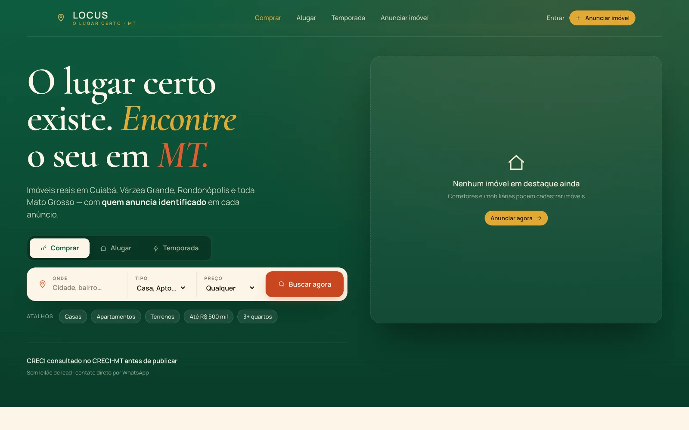

  <a href="https://mmojena.github.io/MiguelMojena/"><strong>Portfólio</strong></a>
  &nbsp;&nbsp; / &nbsp;&nbsp;
  <a href="https://www.linkedin.com/in/miguelmojena/">LinkedIn</a>
  &nbsp;&nbsp; / &nbsp;&nbsp;
  <a href="https://www.instagram.com/miguelmojena/">Instagram</a>

### Prazer, Miguel.

Gosto de transformar ideias em coisas que as pessoas podem usar. Meu trabalho reúne criação de sites para clientes e desenvolvimento de produtos próprios — entre criação, tecnologia e construção de negócios.

Aqui você encontra parte do que estou construindo. No [meu portfólio](https://mmojena.github.io/MiguelMojena/), os projetos ganham contexto e uma apresentação completa.

**No código:** HTML, CSS, JavaScript, TypeScript e Python.

### O que já ganhou forma

<table>
  <tr>
    <td width="42%" valign="middle">
      
    </td>
    <td width="58%" valign="middle">
      <h3>Locus</h3>
      
Plataforma de imóveis em Mato Grosso. Compra, aluguel e temporada.

      
<a href="https://locusmt.tech"><strong>Conhecer o produto ↗</strong></a>

    </td>
  </tr>
  <tr>
    <td width="42%" valign="middle">
      
    </td>
    <td width="58%" valign="middle">
      <h3>Ana Stradiotto</h3>
      
Site para apresentar assessoria de marketing, serviços e projetos.

      
<a href="https://ana-stradiotto.vercel.app/"><strong>Ver o site ↗</strong></a>

    </td>
  </tr>
  <tr>
    <td width="42%" valign="middle">
      
    </td>
    <td width="58%" valign="middle">
      <h3>Antônia Mojena</h3>
      
Site de neuropsicopedagogia, com serviços e contato para atendimento.

      
<a href="https://vortexcorp1.github.io/AntoniaMojena/"><strong>Ver o site ↗</strong></a>

    </td>
  </tr>
</table>

### Vamos dar forma à próxima ideia?

Sites institucionais, landing pages e produtos digitais. O ponto de partida é entender o que você quer colocar no mundo.

**[Conheça meu trabalho e entre em contato](https://mmojena.github.io/MiguelMojena/#contact).**
