<a href="https://mmojena.github.io/MiguelMojena/">
  <picture>
    <source media="(prefers-color-scheme: dark)" srcset="assets/hero-dark.svg" />
    <source media="(prefers-color-scheme: light)" srcset="assets/hero-light.svg" />
    
  </picture>
</a>

  <a href="https://mmojena.github.io/MiguelMojena/"><strong>Portfólio</strong></a>
  &nbsp;·&nbsp;
  <a href="https://www.linkedin.com/in/miguelmojena/">LinkedIn</a>
  &nbsp;·&nbsp;
  <a href="https://www.instagram.com/miguelmojena/">Instagram</a>
  &nbsp;·&nbsp;
  <a href="https://wa.me/5566999772519">WhatsApp</a>

### Prazer, Miguel.

Gosto de transformar ideias em coisas que as pessoas podem usar. Meu trabalho reúne criação de sites para clientes e desenvolvimento de produtos próprios — entre criação, tecnologia e construção de negócios.

Aqui você encontra parte do que estou construindo. No [meu portfólio](https://mmojena.github.io/MiguelMojena/), cada projeto ganha contexto e uma apresentação completa.

<picture>
    <source media="(prefers-color-scheme: dark)" srcset="assets/marquee-dark.svg" />
    <source media="(prefers-color-scheme: light)" srcset="assets/marquee-light.svg" />
    
  </picture>

### O que já ganhou forma

<a href="https://locusmt.tech">
  <picture>
    <source media="(prefers-color-scheme: dark)" srcset="assets/card-locus-dark.svg" />
    <source media="(prefers-color-scheme: light)" srcset="assets/card-locus-light.svg" />
    
  </picture>
</a>

Uma plataforma para encontrar imóveis em Mato Grosso. Compra, aluguel e temporada, conectando quem procura a quem anuncia — uma frente de produto e negócio, além dos sites para clientes. <a href="https://locusmt.tech"><strong>Conhecer o Locus ↗</strong></a>

 

<a href="https://silome.vercel.app">
  <picture>
    <source media="(prefers-color-scheme: dark)" srcset="assets/card-silome-dark.svg" />
    <source media="(prefers-color-scheme: light)" srcset="assets/card-silome-light.svg" />
    
  </picture>
</a>

Um site que conta o universo de uma marca de joias em sete capítulos, da pedra bruta à peça pronta, com cenas que se revelam enquanto você navega. <a href="https://silome.vercel.app"><strong>Conhecer a Silomé ↗</strong></a>

 

<a href="https://vortexcorp1.github.io/AntoniaMojena/">
  <picture>
    <source media="(prefers-color-scheme: dark)" srcset="assets/card-antonia-mojena-dark.svg" />
    <source media="(prefers-color-scheme: light)" srcset="assets/card-antonia-mojena-light.svg" />
    
  </picture>
</a>

Site de apresentação de neuropsicopedagogia: serviços, orientações sobre os atendimentos e contato para agendamento pelo WhatsApp. <a href="https://vortexcorp1.github.io/AntoniaMojena/"><strong>Ver o site de Antônia ↗</strong></a>

 

<a href="https://ana-stradiotto.vercel.app/">
  <picture>
    <source media="(prefers-color-scheme: dark)" srcset="assets/card-ana-stradiotto-dark.svg" />
    <source media="(prefers-color-scheme: light)" srcset="assets/card-ana-stradiotto-light.svg" />
    
  </picture>
</a>

Site para apresentar assessoria de marketing e posicionamento, com serviços, projetos e contato contextual pelo WhatsApp. <a href="https://ana-stradiotto.vercel.app/"><strong>Ver o site de Ana ↗</strong></a>

 

<a href="https://wa.me/5566999772519">
  <picture>
    <source media="(prefers-color-scheme: dark)" srcset="assets/cta-dark.svg" />
    <source media="(prefers-color-scheme: light)" srcset="assets/cta-light.svg" />
    
  </picture>
</a>

  <a href="https://mmojena.github.io/MiguelMojena/"><strong>Portfólio</strong></a>
  &nbsp;·&nbsp;
  <a href="https://www.linkedin.com/in/miguelmojena/">LinkedIn</a>
  &nbsp;·&nbsp;
  <a href="https://www.instagram.com/miguelmojena/">Instagram</a>
  &nbsp;·&nbsp;
  <a href="https://wa.me/5566999772519">WhatsApp</a>

